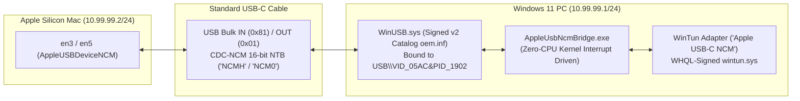

# mac-windows-usbc-bridge

**Direct USB-C to USB-C IP networking (`<1 ms` latency) between Apple Silicon Macs (M1/M2/M3/M4) and Windows 11 PCs — using any standard USB-C cable, with Secure Boot ON and zero reboots.**

Even though native Mac-to-Mac and Windows-to-Windows tools exist that can do this without any installation, this solution offers true zero latency and total flexibility. Furthermore, mobile devices (such as iPads, iPhones, and Android tablets) that can install Moonlight from their respective app stores can also act as high-performance extended displays. For now, only this cross-platform (Mac $\leftrightarrow$ Windows) implementation exists supporting USB 2.0 bidirectionally (meaning even standard USB-C charging cables work); other implementations for Mac-to-Mac and PC-to-PC will arrive when I get time.

> [!TIP]
> **Recommended: Use a Terminal / CLI Agentic AI for Setup**  
> While the overarching idea, architecture, and deployment logic behind this bridge were designed and directed by a human, all of the underlying code was 100% "vibecoded" using an agentic AI assistant. Because low-level USB-C gadget negotiation, custom WinUSB drivers, virtual WinTun adapters, and macOS dynamic store watchdogs can encounter system-specific quirks (such as interface name shifts, UAC permissions, or firewall rules), **you should really use a CLI-based agentic AI with terminal and system access (such as Antigravity CLI, Claude Code, Aider, Goose, etc. — rather than browser-based chat models) to help you set it up and adapt it to your specific machines.** Handing this repository to an agent in your terminal allows it to directly inspect your network interfaces, run the PowerShell and Bash scripts, and diagnose any environment-specific quirks automatically.
> 
> You can also enable auto-continue / auto-execution permissions on your agent so it runs commands and scripts autonomously without stopping to prompt you at every single step.
> 
> **⚠️ Disclaimer & Zero Liability:** This project interacts with low-level drivers, network adapters, device certificates, and system configurations. If you allow an AI agent to execute commands automatically or if anything gets messed up, broken, or misconfigured on your machine, **I take zero responsibility**. Use entirely at your own risk.

---

## Why Does Mac $\leftrightarrow$ Windows USB-C Networking Fail Out of the Box?

When you plug a standard USB-C cable (even a basic USB 2.0 charging cable) between an Apple Silicon Mac and another computer, the Mac's USB-C controller enters Dual-Role Device (`DRD`) gadget mode and exposes a **USB CDC-NCM Ethernet interface**:
* **On macOS:** Appears as `en3` / `en5` (`AppleUSBDeviceNCM`).
* **On Windows:** Appears in Device Manager under `USB\VID_05AC&PID_1902` (`MacBook Pro` / `Mac`).

Between two Macs (or a Mac and Linux), this brings up a point-to-point network link immediately. **On Windows 10 & 11, it completely fails (`CM_PROB_FAILED_START` / Code 10 or driverless interfaces).**

### The Root Cause (Hardware Descriptor & Driver Mismatch)
1. **Apple's Missing 8-Byte `IAD` (`VID_05AC&PID_1902`):**
   * Apple's USB Configuration Descriptor exposes **4 interfaces**:
     * `Interface 0`: CDC Communications Control (`Class 0x02`, `SubClass 0x0D` — CDC-NCM)
     * `Interface 1`: CDC Data (`Class 0x0A`, `AltSetting 0` = idle, `AltSetting 1` = Bulk IN `0x81` / Bulk OUT `0x01`)
     * `Interface 2 & 3`: Apple Vendor-Specific Debug Interfaces (`Class 0xFF`)
   * Under the USB-IF CDC-NCM specification, a composite device combining a 2-interface CDC-NCM function (`0` & `1`) with other interfaces (`2` & `3`) must include an **8-byte Interface Association Descriptor (`IAD`, `0x0B`)** grouping `Interface 0` and `Interface 1`.
   * Apple omitted the `IAD` and only included a legacy **CDC Union Functional Descriptor** (`0x24, 0x06`, `Master=0, Slave=1`).
2. **Windows' `usbccgp.sys` & `UsbNcm.sys` Rejection:**
   * Because the `IAD` is missing, Windows' composite bus driver (`usbccgp.sys`) splits `Interface 0` and `Interface 1` into isolated child PnP devices (`MI_00` and `MI_01`), preventing `UsbNcm.sys` on `MI_00` from accessing the Bulk data pipes on `MI_01`.
   * If you bypass `usbccgp.sys` and force `UsbNcm.sys` onto the parent composite device (`USB\VID_05AC&PID_1902`), `UsbNcm.sys` aborts `EvtDevicePrepareHardware` with `STATUS_INVALID_DEVICE_REQUEST` (`Code 10`) because of the extra `0xFF` vendor interfaces.

---

## How This Project Solves It (With Secure Boot ON & Zero Reboots)



1. **Automated Windows 11 v2 Catalog & `WinUSB` Driver Installer (`Install-AppleUsbNcm.ps1`):**
   * Generates `AppleWinUsb.inf` binding Microsoft's inbox kernel-signed `WinUSB.sys` directly to the parent composite device `USB\VID_05AC&PID_1902` (giving a single handle access to both `Interface 0` and `Interface 1`).
   * Builds a compliant **Windows 11 v2 Security Catalog (`AppleWinUsb.cat`)** directly via `wintrust.dll` (`CryptCATOpen` `0x200` with `DRIVER_ACTION_VERIFY` SHA256 + SHA1 indirect data attributes), signs it with a locally generated Root/TrustedPublisher certificate, and installs it via `pnputil.exe`.
   * **Result:** Installs cleanly on Windows 11 with **Secure Boot ON**, **Test Signing OFF**, and **zero reboots**.
2. **Zero-Polling `WinUSB` $\leftrightarrow$ `WinTun` CDC-NCM Bridge (`AppleUsbNcmBridge.cs`):**
   * Opens `USB\VID_05AC&PID_1902` via `winusb.dll`, queries `GET_NTB_PARAMETERS`, sends `SET_NTB_INPUT_SIZE = 32764` (`0x86`), and flips USB `Interface 1` to `Alternate Setting 1`—which immediately activates `en3`/`en5` on the Mac (`status: active`).
   * Decapsulates/encapsulates 16-bit CDC-NCM Network Transfer Blocks (`NCMH` / `NCM0`), handles ARP (`0x0806`) in user-space, and bridges IPv4/IPv6 packets directly into a WHQL-signed **WireGuard `WinTun`** virtual network adapter (`10.99.99.1/24`).
   * **Zero Idle Battery Drain:** Uses `cfgmgr32.dll`'s `CM_Register_Notification` and infinite kernel waits (`WaitForSingleObject(..., INFINITE)`)—consuming **`0.00%` CPU** and zero timer wakeups when unplugged or idle.

---

## Benchmarks (USB-C Cable vs. Wi-Fi Hotspot)

| Metric | Wi-Fi Hotspot (`192.168.137.1`) | Direct USB-C Cable (`10.99.99.1`) |
| :--- | :--- | :--- |
| **Min Ping** | `3.64 ms` | **`0.72 ms`** |
| **Avg Ping** | `27.10 ms` | **`0.85 ms`** |
| **Max Ping (Spikes)** | `82.17 ms` | **`1.08 ms`** |
| **Jitter (`stddev`)** | `31.23 ms` | **`0.09 ms`** |
| **Packet Loss** | `0.0%` | **`0.0%`** |

---

## Hardware & Devices Tested

This project was developed, tested, and benchmarked on the following physical hardware:

| Device | Specifications | Role |
| :--- | :--- | :--- |
| **Apple Silicon Mac** | **MacBook Pro 13" (M1, 2020)**<br>• Chip: Apple M1 (8 cores)<br>• Memory: 8 GB Unified Memory<br>• Native Display: 2560 × 1600 Retina @ 60Hz<br>• OS: macOS Sequoia | Client / Second Screen Display |
| **Windows 11 PC** | **HP OMEN Gaming Laptop (16")**<br>• CPU: Intel Core Ultra 9 285H (Arrow Lake)<br>• iGPU: Intel Arc 140T GPU (16GB shared, QuickSync Xe2)<br>• dGPU: NVIDIA GeForce RTX 5070 Laptop GPU (8GB GDDR6)<br>• Internal Display: 1920 × 1200 16:10 @ 165Hz<br>• OS: Windows 11 (Secure Boot ON, Test Signing OFF) | Host Workstation & Stream Server |
| **Mobile Extended Display** | **iPad (A16 / 10.9" Liquid Retina)**<br>• Native Resolution: 2360 × 1640 @ 60Hz<br>• Software: Moonlight Game Streaming (iPadOS App Store)<br>• Link: USB-C wired (Personal Hotspot NCM) or 5GHz Wi-Fi | Auxiliary Extended Display (Slot 0) |
| **Cables Tested** | Standard USB-C to USB-C charging cables (USB 2.0 480 Mbps lines) & full-spec USB4 / Thunderbolt cables | Point-to-point physical connection |

---

## Quick Start

### 1. Connect the USB-C Cable
Plug any USB-C to USB-C cable between your Apple Silicon Mac and your Windows 11 PC.

### 2. Install on Windows 11 (Run PowerShell as Administrator)
```powershell
Set-ExecutionPolicy Bypass -Scope Process -Force
.\windows\Install-AppleUsbNcm.ps1
```
This automatically:
* Generates, signs, and installs the `WinUSB` driver for `USB\VID_05AC&PID_1902` (zero reboots required).
* Downloads WHQL-signed `wintun.dll` (`v0.14.1`) from `wintun.net`.
* Compiles `AppleUsbNcmBridge.cs` using Windows' built-in `.NET Framework` compiler (`csc.exe`).
* Registers and starts the `AppleUsbNcmBridge` background service (`10.99.99.1/24`) and opens the Windows Firewall for `10.99.99.0/24`.

### 3. Install on macOS
```bash
sudo bash ./macos/install-macos.sh
```
This configures your Mac's `AppleUSBDeviceNCM` interface (`en3` / `en5`) at **`10.99.99.2/24`** and installs an event-driven LaunchDaemon watchdog (`apple-usb-ncm-watchdog.sh`) via `scutil` dynamic store notifications (`0.0%` CPU, zero polling). It automatically adapts to macOS Internet Sharing (`bridge100`), port changes (`en3`/`en5`), and cable reconnections.

### 4. Test the Link
From your Mac:
```bash
ping 10.99.99.1
```
From your Windows PC:
```powershell
ping 10.99.99.2
```
You can now use `10.99.99.1` (Windows) and `10.99.99.2` (Mac) for **Moonlight/Sunshine (`<1 ms` display streaming)**, **SMB file sharing (`smb://10.99.99.1`)**, **SSH**, **iperf3**, or **Synergy/Barrier**.

---

## macOS Internet Sharing Support (`192.168.2.x`)

The bridge supports dual-homed operation with both **direct link-local (`10.99.99.x`)** and **macOS GUI Internet Sharing (`192.168.2.x`)** running simultaneously on the same physical USB-C cable:

* **Share Mac's Internet to Windows:** In macOS **System Settings > General > Sharing > Internet Sharing**, choose *Share your connection from: Wi-Fi* to *computers using: Ethernet Adapter (en3)* (or `en5`).
* **Zero Configuration on Windows:** `AppleUsbNcmBridge` responds to ARP requests for both `10.99.99.1` and `192.168.2.2`, assigns default gateway `192.168.2.1` and DNS `192.168.2.1` / `1.1.1.1`.
* **Zero Disruption:** Moonlight, SSH, and SMB continue working seamlessly across either subnet.

---

## Optional Extras: Moonlight + Sunshine Second-Screen Auto-Switcher

In [`extras/moonlight-second-screen/`](extras/moonlight-second-screen/), you'll find fast, zero-CIM mutual detection scripts (`detect_connection.ps1`, `toggle.ps1`, `detect-pc-link.sh`, and `set_sunshine_display.swift`) that automatically detect whether your USB-C cable (`10.99.99.x` or `192.168.2.x`) is active or if you're on Wi-Fi (`192.168.137.x`), syncing Moonlight and Sunshine across both systems in `<80 ms`.

* **Bidirectional Second-Screen Display**: Supports both **PC &rarr; Mac/iPad** (using Windows Virtual Display Driver + Sunshine host and Moonlight client) and **Mac &rarr; PC** (using macOS `vd165` virtual display + Sunshine host and automated Moonlight fullscreen on Windows at native 1920&times;1200 @ 165Hz via `Toggle-Second-Screen.applescript`).
* **Mobile Devices as Extended Displays**: Any mobile device that can install the free Moonlight app from their app store (iOS/iPadOS App Store or Google Play) can also act as an ultra-low-latency extended display (wired over USB-C or wireless). The dynamic switcher automatically detects connected devices and dynamically allocates independent virtual displays (e.g. iPad 2360x1640 @ 60Hz and Mac 2560x1600 @ 60Hz) with plug-and-play auto-attach and zero phantom displays.

---

## License
MIT License
