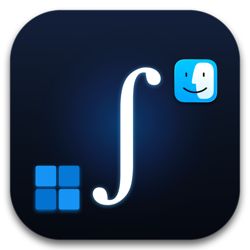
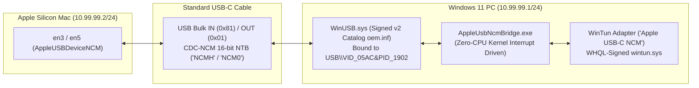

# Integrator (mac-windows-usbc-bridge)

<div align="center">
  
  <h1>Integrator</h1>
  <p><strong>Direct USB-C Workstation Fusion Bridge between Apple Silicon Macs and Windows 11 PCs</strong></p>
  <p>$$\int_{\text{Windows 11}}^{\text{macOS}} (\text{Workstation Fusion})\, dt = \text{\textbf{Integrator}}$$</p>
</div>

**Direct USB-C to USB-C IP networking (`<1 ms` latency) between Apple Silicon Macs (M1/M2/M3/M4) and Windows 11 PCs — using any standard USB-C cable, with Secure Boot ON and zero reboots.**

Even though native Mac-to-Mac and Windows-to-Windows tools exist that can do this without any installation, this solution offers true zero latency and total flexibility. Furthermore, mobile devices (such as iPads, iPhones, and Android tablets) that can install Moonlight from their respective app stores can also act as high-performance extended displays. For now, only this cross-platform (Mac $\leftrightarrow$ Windows) implementation exists supporting USB 2.0 bidirectionally (meaning even standard USB-C charging cables work); other implementations for Mac-to-Mac and PC-to-PC will arrive when I get time.

> [!TIP]
> **Recommended: Use a Terminal / CLI Agentic AI for Setup**  
> While the overarching idea, architecture, and deployment logic behind this bridge were designed and directed by a human, all of the underlying code was 100% "vibecoded" using an agentic AI assistant. Because low-level USB-C gadget negotiation, custom WinUSB drivers, virtual WinTun adapters, and macOS dynamic store watchdogs can encounter system-specific quirks (such as interface name shifts, UAC permissions, or firewall rules), **you should really use a CLI-based agentic AI with terminal and system access (such as Antigravity CLI, Claude Code, Aider, Goose, etc. — rather than browser-based chat models) to help you set it up and adapt it to your specific machines.** Handing this repository to an agent in your terminal allows it to directly inspect your network interfaces, run the PowerShell and Bash scripts, and diagnose any environment-specific quirks automatically.
> 
> You can also enable auto-continue / auto-execution permissions on your agent so it runs commands and scripts autonomously without stopping to prompt you at every single step.
> 
> **⚠️ Disclaimer & Zero Liability:** This project interacts with low-level drivers, network adapters, device certificates, and system configurations. If you allow an AI agent to execute commands automatically or if anything gets messed up, broken, or misconfigured on your machine, **I take zero responsibility**. Use entirely at your own risk.

---

## Why Does Mac $\leftrightarrow$ Windows USB-C Networking Fail Out of the Box?

When you plug a standard USB-C cable (even a basic USB 2.0 charging cable) between an Apple Silicon Mac and another computer, the Mac's USB-C controller enters Dual-Role Device (`DRD`) gadget mode and exposes a **USB CDC-NCM Ethernet interface**:
* **On macOS:** Appears as `en3` / `en5` (`AppleUSBDeviceNCM`).
* **On Windows:** Appears in Device Manager under `USB\VID_05AC&PID_1902` (`MacBook Pro` / `Mac`).

Between two Macs (or a Mac and Linux), this brings up a point-to-point network link immediately. **On Windows 10 & 11, it completely fails (`CM_PROB_FAILED_START` / Code 10 or driverless interfaces).**

### The Root Cause (Hardware Descriptor & Driver Mismatch)
1. **Apple's Missing 8-Byte `IAD` (`VID_05AC&PID_1902`):**
   * Apple's USB Configuration Descriptor exposes **4 interfaces**:
     * `Interface 0`: CDC Communications Control (`Class 0x02`, `SubClass 0x0D` — CDC-NCM)
     * `Interface 1`: CDC Data (`Class 0x0A`, `AltSetting 0` = idle, `AltSetting 1` = Bulk IN `0x81` / Bulk OUT `0x01`)
     * `Interface 2 & 3`: Apple Vendor-Specific Debug Interfaces (`Class 0xFF`)
   * Under the USB-IF CDC-NCM specification, a composite device combining a 2-interface CDC-NCM function (`0` & `1`) with other interfaces (`2` & `3`) must include an **8-byte Interface Association Descriptor (`IAD`, `0x0B`)** grouping `Interface 0` and `Interface 1`.
   * Apple omitted the `IAD` and only included a legacy **CDC Union Functional Descriptor** (`0x24, 0x06`, `Master=0, Slave=1`).
2. **Windows' `usbccgp.sys` & `UsbNcm.sys` Rejection:**
   * Because the `IAD` is missing, Windows' composite bus driver (`usbccgp.sys`) splits `Interface 0` and `Interface 1` into isolated child PnP devices (`MI_00` and `MI_01`), preventing `UsbNcm.sys` on `MI_00` from accessing the Bulk data pipes on `MI_01`.
   * If you bypass `usbccgp.sys` and force `UsbNcm.sys` onto the parent composite device (`USB\VID_05AC&PID_1902`), `UsbNcm.sys` aborts `EvtDevicePrepareHardware` with `STATUS_INVALID_DEVICE_REQUEST` (`Code 10`) because of the extra `0xFF` vendor interfaces.

---

## How This Project Solves It (With Secure Boot ON & Zero Reboots)



1. **Automated Windows 11 v2 Catalog & `WinUSB` Driver Installer (`Install-AppleUsbNcm.ps1`):**
   * Generates `AppleWinUsb.inf` binding Microsoft's inbox kernel-signed `WinUSB.sys` directly to the parent composite device `USB\VID_05AC&PID_1902` (giving a single handle access to both `Interface 0` and `Interface 1`).
   * Builds a compliant **Windows 11 v2 Security Catalog (`AppleWinUsb.cat`)** directly via `wintrust.dll` (`CryptCATOpen` `0x200` with `DRIVER_ACTION_VERIFY` SHA256 + SHA1 indirect data attributes), signs it with a locally generated Root/TrustedPublisher certificate, and installs it via `pnputil.exe`.
   * **Result:** Installs cleanly on Windows 11 with **Secure Boot ON**, **Test Signing OFF**, and **zero reboots**.
2. **Zero-Polling `WinUSB` $\leftrightarrow$ `WinTun` CDC-NCM Bridge (`AppleUsbNcmBridge.cs`):**
   * Opens `USB\VID_05AC&PID_1902` via `winusb.dll`, queries `GET_NTB_PARAMETERS`, sends `SET_NTB_INPUT_SIZE = 32764` (`0x86`), and flips USB `Interface 1` to `Alternate Setting 1`—which immediately activates `en3`/`en5` on the Mac (`status: active`).
   * Decapsulates/encapsulates 16-bit CDC-NCM Network Transfer Blocks (`NCMH` / `NCM0`), handles ARP (`0x0806`) in user-space, and bridges IPv4/IPv6 packets directly into a WHQL-signed **WireGuard `WinTun`** virtual network adapter (`10.99.99.1/24`).
   * **Zero Idle Battery Drain:** Uses `cfgmgr32.dll`'s `CM_Register_Notification` and infinite kernel waits (`WaitForSingleObject(..., INFINITE)`)—consuming **`0.00%` CPU** and zero timer wakeups when unplugged or idle.

---

## Benchmarks (USB-C Cable vs. Wi-Fi Hotspot)

| Metric | Wi-Fi Hotspot (`192.168.137.1`) | Direct USB-C Cable (`10.99.99.1`) |
| :--- | :--- | :--- |
| **Min Ping** | `3.64 ms` | **`0.72 ms`** |
| **Avg Ping** | `27.10 ms` | **`0.85 ms`** |
| **Max Ping (Spikes)** | `82.17 ms` | **`1.08 ms`** |
| **Jitter (`stddev`)** | `31.23 ms` | **`0.09 ms`** |
| **Packet Loss** | `0.0%` | **`0.0%`** |

---

## Hardware & Devices Tested

This project was developed, tested, and benchmarked on the following physical hardware:

| Device | Specifications | Role |
| :--- | :--- | :--- |
| **Apple Silicon Mac** | **MacBook Pro 13" (M1, 2020)**<br>• Chip: Apple M1 (8 cores)<br>• Memory: 8 GB Unified Memory<br>• Native Display: 2560 × 1600 Retina @ 60Hz<br>• OS: macOS Sequoia | Client / Second Screen Display |
| **Windows 11 PC** | **HP OMEN Gaming Laptop (16")**<br>• CPU: Intel Core Ultra 9 285H (Arrow Lake)<br>• iGPU: Intel Arc 140T GPU (16GB shared, QuickSync Xe2)<br>• dGPU: NVIDIA GeForce RTX 5070 Laptop GPU (8GB GDDR6)<br>• Internal Display: 1920 × 1200 16:10 @ 165Hz<br>• OS: Windows 11 (Secure Boot ON, Test Signing OFF) | Host Workstation & Stream Server |
| **Mobile Extended Display** | **iPad (A16 / 10.9" Liquid Retina)**<br>• Native Resolution: 2360 × 1640 @ 60Hz<br>• Software: Moonlight Game Streaming (iPadOS App Store)<br>• Link: USB-C wired (Personal Hotspot NCM) or 5GHz Wi-Fi | Auxiliary Extended Display (Slot 0) |
| **Cables Tested** | Standard USB-C to USB-C charging cables (USB 2.0 480 Mbps lines) & full-spec USB4 / Thunderbolt cables | Point-to-point physical connection |

---

## Quick Start

### 1. Connect the USB-C Cable
Plug any USB-C to USB-C cable between your Apple Silicon Mac and your Windows 11 PC.

### 2. Install on Windows 11 (Run PowerShell as Administrator)
```powershell
Set-ExecutionPolicy Bypass -Scope Process -Force
.\windows\Install-AppleUsbNcm.ps1
```
This automatically:
* Generates, signs, and installs the `WinUSB` driver for `USB\VID_05AC&PID_1902` (zero reboots required).
* Downloads WHQL-signed `wintun.dll` (`v0.14.1`) from `wintun.net`.
* Compiles `AppleUsbNcmBridge.cs` using Windows' built-in `.NET Framework` compiler (`csc.exe`).
* Registers and starts the `AppleUsbNcmBridge` background service (`10.99.99.1/24`) and opens the Windows Firewall for `10.99.99.0/24`.

### 3. Install on macOS
```bash
sudo bash ./macos/install-macos.sh
```
This configures your Mac's `AppleUSBDeviceNCM` interface (`en3` / `en5`) at **`10.99.99.2/24`** and installs an event-driven LaunchDaemon watchdog (`apple-usb-ncm-watchdog.sh`) via `scutil` dynamic store notifications (`0.0%` CPU, zero polling). It automatically adapts to macOS Internet Sharing (`bridge100`), port changes (`en3`/`en5`), and cable reconnections.

### 4. Test the Link
From your Mac:
```bash
ping 10.99.99.1
```
From your Windows PC:
```powershell
ping 10.99.99.2
```
You can now use `10.99.99.1` (Windows) and `10.99.99.2` (Mac) for **Moonlight/Sunshine (`<1 ms` display streaming)**, **SMB file sharing (`smb://10.99.99.1`)**, **SSH**, **iperf3**, or **Synergy/Barrier**.

---

## Bidirectional Internet Sharing (Mac &harr; Windows)

The bridge supports dual-homed operation with **direct link-local (`10.99.99.x`)** running simultaneously alongside native internet sharing in **either direction** over the exact same physical USB-C cable:

* **Share Mac's Internet to Windows (`192.168.2.x`):** 
  * In macOS **System Settings > General > Sharing > Internet Sharing**, choose *Share your connection from: Wi-Fi* to *computers using: Ethernet Adapter (en3)* (or `en5`).
  * `AppleUsbNcmBridge` responds to ARP requests for both `10.99.99.1` and `192.168.2.2`, assigns default gateway `192.168.2.1` and DNS `192.168.2.1` / `1.1.1.1` to Windows automatically.
* **Share Windows' Internet to Mac (`192.168.137.x`):** 
  * In Windows **Network Connections (`ncpa.cpl`)**, right-click your active connection (e.g. high-speed physical Ethernet or 5G SIM card) &rarr; **Properties > Sharing > "Allow other network users to connect"** and select **Apple USB-C NCM**.
  * Windows ICS automatically binds gateway `192.168.137.1` and runs DHCP/NAT. The Mac receives high-speed wired internet directly over the USB-C charging cable without requiring a bulky USB-C Ethernet dongle!
* **Zero Disruption:** Moonlight, SSH, and SMB continue working seamlessly across either subnet regardless of which machine is sharing internet.

---

## Legacy Proof-of-Concept & Moonlight Auto-Switcher

In [`Legacy/moonlight-second-screen/`](Legacy/moonlight-second-screen/), you'll find fast, zero-CIM mutual detection scripts (`detect_connection.ps1`, `toggle.ps1`, `detect-pc-link.sh`, and `set_sunshine_display.swift`) that automatically detect whether your USB-C cable (`10.99.99.x` or `192.168.2.x`) is active or if you're on Wi-Fi (`192.168.137.x`), syncing Moonlight and Sunshine across both systems in `<80 ms`.

* **Bidirectional Second-Screen Display**: Supports both **PC &rarr; Mac/iPad** (using Windows Virtual Display Driver + Sunshine host and Moonlight client) and **Mac &rarr; PC** (using macOS `vd165` virtual display + Sunshine host and automated Moonlight fullscreen on Windows at native 1920&times;1200 @ 165Hz via `Toggle-Second-Screen.applescript`).
* **Mobile Devices as Extended Displays**: Any mobile device that can install the free Moonlight app from their app store (iOS/iPadOS App Store or Google Play) can also act as an ultra-low-latency extended display (wired over USB-C or wireless). The dynamic switcher automatically detects connected devices and dynamically allocates independent virtual displays (e.g. iPad 2360x1640 @ 60Hz and Mac 2560x1600 @ 60Hz) with plug-and-play auto-attach and zero phantom displays.

---

## ⚡ Integrator: The Unified Desktop Companion App (`v1.0.0` - Current Progress)

> [!IMPORTANT]
> **Project Status: Companion App Built & Operational!**  
> What originally began as a collection of standalone shell scripts and PowerShell drivers has officially evolved into **Integrator**: a single, unified desktop companion application for macOS and Windows 11 built with memory-safe **Rust (Tauri v2)**.
>
> * **Icon & Branding**: Features a custom mathematical integration icon ($\int_{\text{Windows 11}}^{\text{macOS}}$) featuring a centered integral sign with pixel-matched Windows 11 (bottom-left) and macOS Finder (top-right) limits separated by a clean 54 px air-gap.
> * **Zero Ghost Daemons**: Enforces strict single-instance mutual exclusion. Quitting the application cleanly terminates all background threads with zero persistent `launchd` or `schtasks` reload daemons.
> * **Master ON/OFF Switches**: Every single fusion feature has an independent, persistent master toggle that gracefully winds down active socket streams, unmounts volumes, or dismisses HUDs when disabled.
> * **Clean Launch at Login**: Autostart is managed natively via macOS Login Items (`System Settings ➔ Login Items`) and Windows `HKCU\...\Run` with `CREATE_NO_WINDOW`.

### Feature Implementation Status Matrix

| Fusion Feature | Platform | Status | Implementation Details |
| :--- | :---: | :---: | :--- |
| **Direct USB-C CDC-NCM Bridge** | macOS & Win 11 | ✅ **Live** | Zero-polling `WinUSB` $\leftrightarrow$ `WinTun` (`<0.7ms` ping, 0.00% idle CPU) |
| **Dual-Subnet Networking & ICS** | macOS & Win 11 | ✅ **Live** | Bidirectional Internet Sharing simultaneously alongside `10.99.99.x` direct link |
| **Tauri v2 Glassmorphic UI** | macOS & Win 11 | ✅ **Live** | Real-time latency, peer IP discovery, category filters, and live status pills |
| **Universal Clipboard (Text & Images)** | macOS & Win 11 | ✅ **Live** | Bidirectional text & PNG/TIFF with SHA-256 echo-loop prevention |
| **Universal Clipboard (Folders & Files)** | macOS & Win 11 | ✅ **Live** | Multi-GB recursive folder copy-paste streaming over NVMe buffers with LRU pruning |
| **Live Network Benchmark Engine** | macOS & Win 11 | ✅ **Live** | Built-in real-time throughput benchmark saturating USB-C NVMe transfer speeds |
| **Touch Bar NVIDIA Performance HUD** | macOS (client) | ✅ **Live** | Liquid Glass OLED HUD with interactive physics and native Control Strip integration |
| **Auto-Mounted Shared Storage** | macOS & Win 11 | ✅ **Live** | Automatic mounting & clean teardown for `/Volumes/PC` $\leftrightarrow$ `M:\` mapped drive |
| **True Tone & Chromatic Adaptation** | macOS & Win 11 | ✅ **Live** | Mac ambient sensor (Kelvin) $\to$ Bradford CAT GPU gamma ramp injection |
| **Dynamic Audio Routing** | macOS & Win 11 | ✅ **Live** | System tray topology switcher (Mac Studio Speakers, PC Only, Dual Sync) |
| **Second-Screen Extended Display** | macOS & Win 11 | ✅ **Live** | Bidirectional 165Hz / 60Hz streaming via Sunshine host + Moonlight client |
| **Master ON/OFF Feature Switches** | macOS & Win 11 | ✅ **Live** | Independent persistent toggles saved to `~/.usbc_clipboard_cache/features.json` |
| **Native Launch at Login** | macOS & Win 11 | ✅ **Live** | System Events Login Item (macOS) & `HKCU\...\Run` (Win 11) |
| **Touch ID Passkey & Windows Lock** | macOS & Win 11 | 🚧 **Scaffolded** | WebAuthn FIDO2 HID over USB/IP + Credential Provider DLL (`LogonUI.exe`) |
| **Apple Precision Trackpad Gestures** | macOS & Win 11 | 📋 **Planned** | Raw contact points streamed to virtual `vmulti` Precision Touchpad driver |
| **Universal Camera & Virtual Mic** | macOS & Win 11 | 📋 **Planned** | Hardware-accelerated `CMIOExtension` & DirectShow virtual media pipelines |
| **Multi-WAN Packet Bonding** | macOS & Win 11 | 📋 **Planned** | Dynamic dual-gateway load balancing, ping protection, and failover |

---

### Building & Running the Integrator Desktop App

The companion app is located in the [`app/`](app/) directory:

#### On macOS:
```bash
cd app
cargo build --release
```
To run the packaged bundle or copy to your Applications folder:
```bash
# Executable binary located at:
./target/release/integrator

# Packaged macOS Application bundle:
open /Applications/Integrator.app
```

#### On Windows 11:
```powershell
cd app
cargo build --release
```
The compiled release executable with the embedded $\int_{\text{Win11}}^{\text{macOS}}$ multi-resolution icon will be located at `target\release\integrator.exe`.

---

### The Two Core Operating States

The unified app is designed around **two primary, mutually exclusive operating states** that govern how the two computers interact:

```
┌────────────────────────────────────────────────────────────────────────┐
│                        PRIMARY OPERATING STATES                        │
│                                                                        │
│   ┌─────────────────────────────────┐ ┌────────────────────────────┐   │
│   │   STATE 1: EXTENDED DESKTOP     │ │ STATE 2: INPUT SHARING     │   │
│   │   • Single OS across displays   │ │ • Dual OS running together │   │
│   │   • Master & Slave hierarchy    │ │ • Dynamic Temporary Master │   │
│   │   • Slave inputs map to Master  │ │ • Active OS dictates keys  │   │
│   └─────────────────────────────────┘ └────────────────────────────┘   │
└───────────────────────────────────┬────────────────────────────────────┘
                                    │
               ┌────────────────────┴───────────────────┐
               ▼                                        ▼
┌────────────────────────────────────────────────────────────────────────┐
│                     INDEPENDENT MODULAR TOGGLES                        │
│  [✓] Universal Clipboard   [✓] Shared Folders   [✓] Camera & Mic       │
└────────────────────────────────────────────────────────────────────────┘
```

#### 🖥️ State 1: Extended Desktop Mode (Single-OS Workspace)
*In this mode, only **one operating system** is in control of the entire physical workspace, using the other machine's screen as a high-refresh external monitor.*

* **Role Definitions:**
  * **Master (Host):** The primary computer running the operating system and transmitting the low-latency display feed (e.g., your MacBook running macOS).
  * **Slave (Client):** The secondary computer whose physical screen acts as the extended display (e.g., your Windows laptop running the client display).
* **Unified Input & Smart Modifier Mapping:**
  * All input devices connected to the **Slave** (its built-in keyboard, trackpad, mouse, touchscreen) are forwarded across the USB-C link to control the **Master**.
  * **Automatic Modifier Translation:** Keystrokes originating on the Slave are dynamically remapped to match the Master's native OS conventions:
    * *When Mac is Master and Windows is Slave:* Pressing `Ctrl + C` or `Ctrl + V` on the Windows laptop keyboard maps to `Command ⌘ + C` / `Command ⌘ + V` on the Mac host.
    * *When Windows is Master and Mac is Slave:* Pressing `Command ⌘` on the Mac keyboard maps to `Ctrl` (or `Windows Key`) on the Windows host.
* **Touch Bar Integration (Windows Telemetry & Control Strip):**
  * When Windows is the Master and an OLED Touch Bar-equipped Mac acts as the extended display/terminal, the frontmost Mac client app captures the Touch Bar via `NSTouchBar`.
  * **Off-Screen NVIDIA Performance HUD**: Direct queries to NVIDIA Management Library (`nvml.dll` on Windows) stream GPU temperatures, power draw (Watts), GPU utilization, and clock speeds onto the 2170&times;60 OLED strip. This gives gamers a real-time hardware HUD without cluttering the primary gaming monitor with intrusive on-screen overlays (like GeForce `Alt+R`).
  * **Strict Scope Isolation**: Windows **only** gains control of the Touch Bar while in this specific mode. When Mac is the Master, or when running in Input Sharing mode, macOS retains 100% native control over its Touch Bar.

#### 🖱️ State 2: Universal Input Sharing Mode (Dual-OS KVM Workspace)
*In this mode, **both operating systems** run independently and visibly side-by-side. You use a single keyboard and mouse seamlessly across both machines via clean-room edge-hopping.*

* **Role Definitions (Dynamic Handover):**
  * **Temporary Master:** Whichever computer currently holds the active cursor on its screen.
  * **Temporary Slave:** The computer whose screen is currently idle without the cursor.
* **Dynamic Keyboard & Modifier Governance:**
  * The **Temporary Master** dictates the active keyboard mapping rules.
  * Whichever physical keyboard you type on, the inputs strictly adapt to the operating system where the cursor currently resides:
    * When your cursor crosses the border onto the **Mac**, the active modifier context switches to macOS (`Command ⌘` shortcuts, Mac-specific accents).
    * When your cursor crosses back onto **Windows**, the active modifier context immediately switches to native Windows (`Ctrl` / `Alt` / `Win` shortcuts).
* **Apple Glass Trackpad &rarr; Windows Precision Touchpad Gestures:**
  * When controlling Windows from the Mac, raw multi-touch contact points are streamed to a virtual **Windows Precision Touchpad** driver (`vmulti`).
  * Enables native Windows 11 multi-finger gestures on the Mac trackpad: **3-finger swipe up** for Task View, **3-finger swipe left/right** for Virtual Desktops, and 165Hz smooth inertia scrolling and pinch-to-zoom.
* **Bi-Directional Input Agnostic:** Seamlessly accepts input whether the user is typing on the MacBook keyboard/trackpad or their Windows gaming mouse and mechanical keyboard.
* **Edge Detection & Guard Logic:**
  * **Dead Corners:** User-configurable edge margins to prevent accidental switching when clicking the Apple menu, taskbars, or window close buttons (`X`).
  * **Switch Delay & Double-Tap:** Optional threshold buffers (e.g., 50–100ms) requiring an intentional push against the border to initiate the hop.

---

### Independent Modular Features (Toggleable On / Off)

Regardless of whether the app is in **Extended Desktop** or **Input Sharing** mode, all other features operate as independent modular background services that can be enabled or disabled individually:

* **📋 Universal Clipboard:**
  * Bidirectional clipboard synchronization for plain text, rich text (HTML/RTF), and image bitmaps (PNG/JPEG).
  * Hash-based deduplication (SHA-256) to prevent infinite ping-pong echo loops between devices.
* **📂 Cross-Border File Drag & Drop ("AirDrop Across Screens"):**
  * Click and drag any file from macOS Finder past the screen boundary onto the Windows desktop (or vice versa).
  * A semi-transparent ghost thumbnail follows the cursor across operating systems, and releasing the mouse button streams the file buffer over the USB-C link directly into the target folder in milliseconds.
* **📁 Auto-Mounted Shared Folders:**
  * Designated user folders automatically mount into `/Volumes/PC` on macOS and a mapped drive (e.g., `M:`) on Windows upon link connection.
  * Clean, automated unmounting when the USB-C cable is unplugged—zero hanging Finder or Explorer windows.
* **🔑 Touch ID as a Windows Security Key & Passkey Authenticator:**
  * **Browser & Passkey Mode (WebAuthn / FIDO2 over Virtual USB/IP)**:
    * Turns your Mac into a biometric hardware security key (like a YubiKey) for Windows 11.
    * When Windows or a browser (Chrome/Edge) prompts for a WebAuthn passkey or hardware security key (Google, Microsoft, GitHub login), the Windows agent exposes a virtual FIDO2 HID device (`0xF1D0`) over `USBIP-Win`.
    * The Mac prompts Touch ID via `LocalAuthentication`, the Secure Enclave signs the assertion, and Windows completes authentication seamlessly with zero physical driver renegotiation.
  * **Native Windows 11 Lock Screen Unlock (Custom Credential Provider)**:
    * Solves the consumer Windows 11 lock screen limitation (where FIDO2 keys are restricted to Microsoft Entra ID / Azure AD) for fingerprint-less laptops like the HP OMEN.
    * Integrates a custom Windows Credential Provider DLL (`TouchIdCredentialProvider.dll`) directly into `LogonUI.exe`.
    * User credentials remain sealed with Windows **DPAPI**. When locked, a challenge nonce is transmitted over `10.99.99.x`.
    * Resting your finger on the MacBook’s Touch ID sensor signs the nonce via the Apple Secure Enclave (`kSecAccessControlTouchIDCurrentSet`). The Credential Provider validates the signature and hands the logon token to **LSASS**, unlocking the Windows desktop in `<150ms`.
* **🎨 True Tone & Chromatic Adaptation Sync (Bradford CAT):**
  * Reads ambient room lighting (CCT in Kelvin) from the Mac’s bezel ambient sensor.
  * Applies a **Bradford Chromatic Adaptation Transform (CAT)** with perceptual gamma compensation for matte vs. glossy panel differences.
  * Injects the resulting curves directly into the Windows GPU hardware Look-Up Table (`SetDeviceGammaRamp`) in `<0.1 ms`, ensuring both screens smoothly transition to the exact same paper-white warmth as ambient room lighting changes.
* **🎥 Universal Camera & Virtual Microphone:**
  * Stream the MacBook’s FaceTime HD camera and studio mic into Windows as a native DirectShow / Media Foundation webcam.
  * Stream Windows camera or studio audio hardware into macOS via modern `CMIOExtension` virtual camera plugins.
  * Hardware-accelerated low latency (Apple VideoToolbox & NVIDIA NVENC).
* **🔊 Dynamic Audio Routing (System Tray Selector):**
  * Switch between three distinct audio routing topologies on the fly directly from the macOS Menu Bar or Windows System Tray:
    * **Mac Studio Speakers Only**: Automatically mutes the PC and pipes uncompressed 24-bit master audio to the MacBook's high-fidelity Spatial Audio sound system (<6ms latency).
    * **Windows PC / Headset Only**: Leaves audio on the PC (ideal when gaming with a low-latency headset or DAC plugged into Windows).
    * **Dual Stereo / Surround (Both Simultaneously)**: Plays across both physical machines with an integrated millisecond sync-calibration slider to eliminate room echo and comb-filtering.
* **📡 Zero-Config Pairing & Automatic Handover:**
  * Instant mutual peer discovery across direct USB-C (`10.99.99.x` / `192.168.2.x`) and local Wi-Fi.
  * Seamless fallback to wireless if the cable is disconnected, and instant handover to wired speed when plugged back in.
  * End-to-end encrypted control channel (TLS 1.3 / Noise Protocol) with a one-time 6-digit PIN pairing handshake.
* **🌐 Multi-WAN Bonding & Dynamic Dual-Gateway Load Balancing:**
  * Turns your desk into a high-availability dual-WAN router node by bonding independent internet connections across both machines over the `<0.6ms` USB-C interconnect:
    * **Local Multi-Socket Balancing (Zero 3rd Device / Zero Cloud)**: Routes distinct connections and chunked downloads (HTTP range requests, Steam, git clones, large assets) across both connections simultaneously (e.g. 100 Mbps Mac Wi-Fi + 150 Mbps Windows 5G/Ethernet = 250 Mbps combined throughput) without session breaking or account lockouts.
    * **Traffic Isolation & Ping Protection**: Routes latency-sensitive gaming packets (UDP) exclusively through the stable wired connection while offloading heavy background downloads and 4K video to the secondary link, guaranteeing zero in-game ping spikes.
    * **True Packet Bonding (Cloud-Assisted Option)**: For seamless single-stream aggregation (e.g. uninterrupted Zoom calls or live Twitch broadcasts across dropping Wi-Fi), optionally tunnels through an MPTCP / Speedify-style VPS proxy to present a single unified public IP.

---

### 🛡️ Architectural Safeguards & Quality of Service (QoS)

To guarantee that the companion app never causes frame drops, audio stutter, memory thrashing, or connection drops—even under worst-case cable bottlenecks—the system enforces strict hardware safeguards:

#### 1. Bandwidth Precedence & Automatic Degradation Ladder (USB 2.0 Fallback)
When running all features simultaneously over a standard USB-C charging cable (USB 2.0 physical limit: 480 Mbps half-duplex / ~320 Mbps usable throughput), the daemon's internal packet scheduler enforces a strict **6-Tier QoS Hierarchy**:

```
[ Tier 0: Strict Priority ]  Mouse, Keyboard, Touch ID, Keepalives    (< 0.5 Mbps)  --> NEVER DELAY / NEVER DROP
[ Tier 1: Isochronous     ]  Low-Latency Audio (Mac Soundbar Sink)    (~ 0.3 - 2 Mbps) --> DYNAMIC OPUS FALLBACK
[ Tier 2: Real-Time Stream]  165Hz Display (Sunshine -> Moonlight)    (Adaptive)   --> DYNAMIC BITRATE ABR / FRAME DROP
[ Tier 3: Secondary Video ]  Universal Webcam Feed                    (Adaptive)   --> DOWNSCALED TO 720p30
[ Tier 4: Background Bulk ]  File Drag-and-Drop / Large Clipboard     (Elastic)    --> TOKEN-BUCKET CLAMPED
[ Tier 5: Scavenger       ]  Multi-WAN / Two-Way Internet Sharing     (Elastic)    --> FIRST TO BE CHOKED
```

* **Automatic Graceful Degradation Ladder**:
  1. *Link > 220 Mbps*: Audio automatically flips from uncompressed 24-bit PCM to transparent Opus (256 kbps), saving ~2 Mbps with zero audible difference.
  2. *Link > 250 Mbps*: Background file transfers and internet sharing are clamped to a 40 Mbps ceiling via a token-bucket rate limiter.
  3. *Queue Delay > 12ms*: Sunshine drops HEVC bitrate dynamically (80 Mbps $\to$ 35 Mbps) via NVENC/VideoToolbox rate control.
  4. *Persistent Congestion*: Universal Webcam scales down from 1080p60 to 720p30.
  5. *Critical Saturation*: Display frame rate steps down (165Hz $\to$ 120Hz $\to$ 60Hz), dropping frames rather than buffering latency. **Input (Tier 0) is never delayed.**

#### 2. Hardware Engine & Memory Safeguards (8 GB M1 & RTX 5070 Rules)
* **Apple M1 Single Media Engine Protection**: The base M1 processor features **only one hardware video encode ASIC**. Running a 165Hz display stream concurrently with a 1080p webcam will time-slice the encoder (spiking display latency from 5ms to 30ms) or drop to CPU software encoding. When the 165Hz display is active, the webcam stream automatically drops to 720p or utilizes uncompressed USB transfer to spare the hardware encoder.
* **Zero-RAM File Streaming Policy**: On memory-constrained machines (such as 8 GB unified memory MacBooks), the clipboard and drag-and-drop engines are strictly forbidden from buffering files in RAM. All transfers use fixed 64 KB ring buffers streaming directly from disk to disk (`std::fs::File`), guaranteeing an active memory footprint under 35 MB regardless of whether transferring 10 MB or 50 GB.
* **macOS `WindowServer` 165Hz Idle Throttling**: To prevent `WindowServer` from consuming 40–60% CPU redrawing static frames at 165Hz, the capture engine monitors dirty rectangles. When no screen changes occur for >200ms, frame polling drops to 10 FPS and ramps back to 165 FPS on the first cursor movement.
* **Dedicated CDC-NCM Cable Integrity**: The physical USB-C connection never re-enumerates or switches device personalities live. The physical wire remains 100% CDC-NCM Ethernet (`10.99.99.x`), and all auxiliary USB devices (FIDO2 keys, virtual gamepads, Precision Trackpad) are virtualized over IP, eliminating physical bus disconnects.

---

*The ultimate goal: two computers, one workspace.*

---

## License
MIT License
